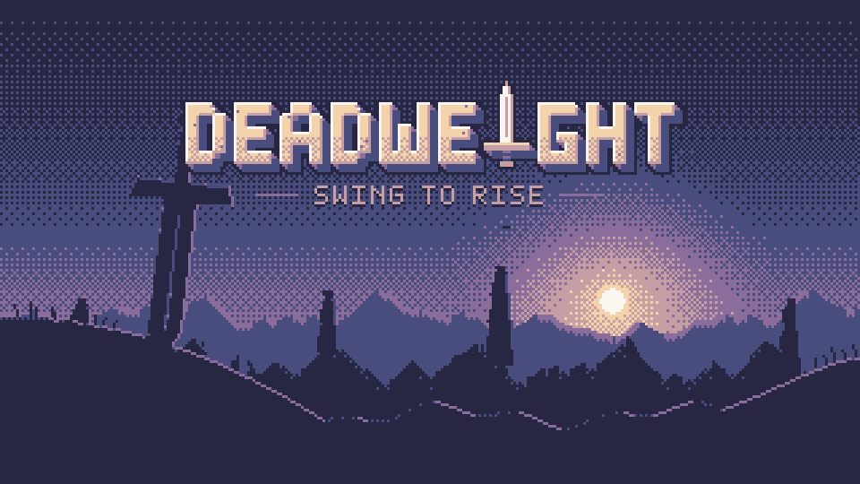
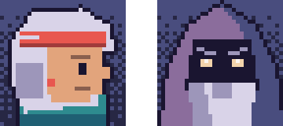
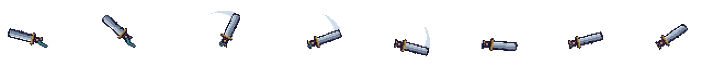
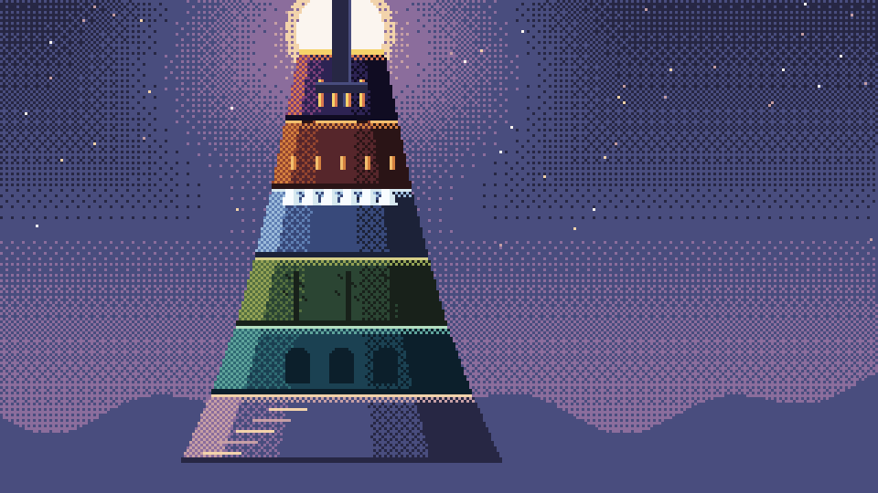
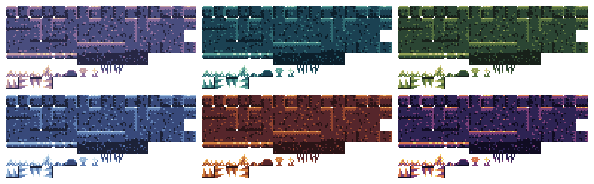
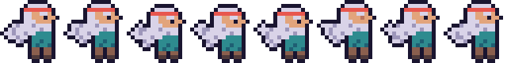
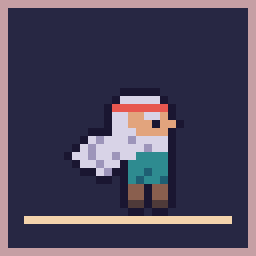

<p align="center">
  
</p>

<h1 align="center">DEADWEIGHT</h1>
<p align="center"><em>Swing to rise.</em></p>

<p align="center">
  <a href="https://ashenrogue.itch.io/deadweight"><strong>▶ Play on itch.io</strong></a> &nbsp;·&nbsp; password: <code>temp</code>
</p>

A 2D pixel-art precision platformer made in Unity. You carry a sword far too big to fight with, and swinging it is how you move: the blade drags you wherever you swing it. Climb six areas of the Spire, earn a new skill in each one, and pull the Deadweight out of the peak so the sun can rise again.

This repo holds the **full Unity project**, the game's **art, audio and level files**, a [complete asset list](ASSETS.md), the [AI prompt & generation log](docs/DEADWEIGHT_Prompt_Generation_Log.pdf), and this write-up of how the game was made.

---

## Contents

1. [The game](#the-game)
2. [How it was made: overview](#how-it-was-made-overview)
3. [Development timeline](#development-timeline)
4. [Technical design](#technical-design)
5. [Testing and release](#testing-and-release)
6. [AI use](#ai-use)
7. [What's in this repo](#whats-in-this-repo)
8. [Opening the project](#opening-the-project)
9. [Lessons learned](#lessons-learned)

---

## The game

> *A hundred years ago, the sun stopped rising.*
> *They say a blade older than the mountain pins it to the peak.*
> *They call it the Deadweight.*

**Wren** is a climber carrying the **Shard**, a broken piece of that blade. The Shard wants to go home, so when Wren swings it, it hauls him after it. **Marrow**, a hooded old voice at the foot of the mountain who once tried the climb himself, sends him up. At the summit he pulls the Deadweight free, the blade crumbles, and the sun finally rises.

<p align="center"></p>

### Core mechanic

The swing *is* the movement. You aim with the stick or arrow keys (8 directions), swing, and the sword launches you that way. You get one launch in the air and it refreshes when you land. Every area adds a skill that changes how that launch works, and the level design after it is built around that skill.

<p align="center"></p>

### The six areas

Each area has its own six-colour palette, background, hazards and skill. The level-select screen shows the Spire from the outside, with one band per area.

<p align="center"></p>

| # | Area | Skill earned | What the skill does |
|---|---|---|---|
| 1 | **The Cinder Foot**: where every climb begins | Wall Grip | Cling to walls in the air, then leap away |
| 2 | **The Drowned Cistern**: sealed behind cracked stone | Breaker | Swings shatter cracked stone |
| 3 | **The Hollow Garden**: where the last trees died standing | Twin Edge | Swing twice before touching the ground |
| 4 | **The Pale Ledges**: cold light, no warmth | Shard Pulse | Ghost stone turns solid for a few seconds |
| 5 | **The Rust Foundry**: the forge that cast the blade | Ricochet | Swing into a surface to bounce off it |
| 6 | **The Zenith**: the sun is waiting | — | The finale: use everything |

Each skill comes from a relic altar left by an earlier climber, with a line of lore (for example *"Varek forged the Deadweight. He never said why it rings back when you strike."*).

<p align="center"></p>

### Controls

| Action | Keyboard | Gamepad |
|---|---|---|
| Move / aim | WASD or arrows | Stick or D-pad |
| Jump | Space | A |
| Swing | Click or Enter | X |
| Launch | Left Shift | RB or L3 |
| Shard Pulse | E | Y |
| Pause | Esc or P | Start |

---

## How it was made: overview

| | |
|---|---|
| **Engine** | Unity 6 (6000.3.10f1), Universal Render Pipeline 2D, Input System, Cinemachine, Pixel Perfect Camera |
| **Resolution** | 320×180, 8×8 tiles, 16×16 character, 16 pixels per unit |
| **Palette** | `#272744` `#494d7e` `#8b6d9c` `#c69fa5` `#f2d3ab` `#fbf5ef` (plus one palette per area) |
| **Code** | ~60 C# scripts: 46 runtime scripts and 16 editor tools |
| **Art** | Procedural pixel art drawn by Python scripts (PIL + numpy) from text prompts. No image-generation model |
| **Music** | *Beneath the Dead Sun*, generated in Gemini |
| **Sound** | 28 retro sound effects synthesised in code at runtime |
| **Levels** | 6 text-grid level files, 2,200–3,561 tiles wide |
| **Platform** | WebGL build on itch.io |

This was built as coursework with a professor, which included documenting every AI generation. I directed the design, made the calls, and tested and debugged in Unity. Claude wrote the code, story text and procedural art from my prompts, and I made the music with Gemini. Every prompt is in the [prompt & generation log](docs/DEADWEIGHT_Prompt_Generation_Log.pdf), and the [AI use](#ai-use) section summarises it.

---

## Development timeline

### 0. It started as a card game (April 2026)

The Unity project is still called *Card Game*. It began as a deck-building prototype (cards, a deck, a hand, a game manager), which is archived in `_Archive_CardGame/`. Then the idea of a sword so heavy it moves *you* took over, and the project became a platformer.

### 1. Hand-made prototype (May – July 2026)

The first version was all hand-made in Aseprite: a basic tileset, a lab/sandbox tileset and background, the first main character and a separate sword sprite. The code was simple test mechanics: a moving vertical platform, a rotating platform, a zero-friction "slippery walls" physics material, and sword attack particles. This proved the swing-to-move idea felt good before any real art went in.

### 2. Art pass (October 6, 2026). Prompts #1–#15

I gave Claude the hard constraints: a 320×180 screen, 8×8 tiles, a 16×16 character split into two sprites (body and sword), and a six-colour dark palette. The character could use extra colours, as long as they meshed with that palette. Then I iterated:

- **Character design (#2):** Celeste-inspired, but an older figure with a free-flying beard; the sword is a Guts-style slab that looks far too heavy to carry. Both were drawn as SVG and PNG.
- **Animations (#3, #5):** Walk, Run, Jump and Slash, 8 frames each, as separate body and sword-layer strips so they can be layered in Unity.
- **Fixing the slash (#7–#10):** The first slash swung *behind* the player, which didn't make physical sense. I asked for it in front, then for the character to always face right (Unity flips the sprite). For 8-direction aiming, we drew five slashes (forward, forward-up, up, forward-down, down) and mirror them for the rest. I also cut the windup to 5–6 frames so the swing feels snappy. The old versions are kept in `assets/Player/_archive/`.
- **Background (#11):** A five-layer parallax scene (sky, clouds, far and mid mountains, forest) based on a reference image I supplied.
- **Tileset (#12):** 8×8, with 89 tile definitions (terrain edges and fills, back walls, hanging pieces, decor) plus a JSON layout map.
- **Decor sway (#13, #14):** 4-frame sway strips for grass and flowers so the world feels alive.
- **Idles (#15):** A base idle plus four "rare chance" idles: shake, stretch, sword flourish and shoulder tap.

<p align="center"></p>

### 3. Getting it into Unity (October 8). Prompts #16–#26

This phase was mostly debugging the pipeline:

- **Blurry sprites and wrong colours (#17, #18):** Pixel art needs *Point* filtering, *no compression* and 16 PPU. Unity's defaults blur and recolour it.
- **Importer tool:** Instead of setting up dozens of sheets by hand, an editor script (`PlayerArtBuilder`) slices every sheet, builds all the body and sword animation clips and controllers, wires up the player, and builds the tile palette and parallax prefab. It's safe to re-run, which mattered because the art kept changing.
- **Two-layer animation:** `PlayerAnimationDriver` keeps the body and sword animators in lockstep. Swings pick the slash animation from where you're aiming.
- **Layout bugs (#22–#26):** a missing SpriteRenderer on the sword layer, a background that didn't quite fill the screen, and a tilemap that lost its ground collider. Each one was fixed in the builder scripts so they wouldn't come back.

### 4. Main menu, story and music (October 11). Prompts #27–#38

- **Main menu (#27):** Same palette, but with the sun farther away and more of the darkness showing. It has nine parallax layers with 4×4 Bayer ordered dithering, a foreground cliff with the giant sword planted in it, drifting mist, twinkling stars and rising embers. The title is hand-built 5×7 block lettering with the "I" drawn as a sword. A `MainMenuBuilder` tool builds the whole scene.
- **Story (#31):** I asked for a story with a clear goal and an ending, an opening cutscene, and a dialogue box. That produced the dead sun, the Spire, Wren, Marrow and the Deadweight, plus three narration cards and a short conversation after Wren's fall. The dialogue uses a custom 5×7 pixel font drawn by code (`PixelText`), so text is always crisp.
- **Cutscene bugs (#32–#35):** The intro showed a blank screen for 10 seconds because the black fade was drawn on top of the narration. It was fixed by reordering the canvas.
- **Music (#36):** I wrote a prompt for Gemini that included the palette, a screenshot of the menu and the full story text, and asked for a slow track with no lyrics. The result, *Beneath the Dead Sun*, loops on the menu with a fade-in.
- **Camera (#36–#38):** A stray second camera was rendering on top of the real one. `FixGameCamera` removed it and set up a Pixel Perfect Camera at 320×180.

<p align="center"></p>

### 5. Six areas, skills and a real progression (October 12 – 18)

This is where it turned from a test level into a game, in sessions after the prompt log:

- **Level catalog:** six areas, each with a title, subtitle, blurb, six-colour palette and the skill its altar grants.
- **Skills as a design spine:** each skill is introduced in one area, and the rest of that area and every area after it is built around it. Skills are bit flags, so a save is a single integer.
- **Data-driven levels:** levels are written as text grids (see [Technical design](#technical-design)), and `LevelBuilder` turns each file into a full scene: tilemaps, colliders, hazards, checkpoints, altar, exit, parallax and decor.
- **Area art:** `AreaArt` recolours the tileset per palette and slices each area's props and five background layers.
- **Going big:** the first pass of the six levels totalled about 190 KB of level data. I wanted each level expanded into many areas, starting easy and ramping up, so the same day they grew to about 4.2 MB, roughly 20× larger.
- **Story arc:** the level-select Spire, the ending sequence (the Deadweight comes free and the sun rises), and the relic lore for each skill.
- **Mechanic rewrite:** once the slash moved in front of the player, Marrow's line changed from "swing it *away* from where you want to go" to "swing it *where* you want to go, and it drags you after it".

### 6. Polish and "juice" (through November 12)

- **Sound:** 28 sound effects synthesised from square and noise waves in `Sfx.cs`, so the build ships no audio files for them. Any sound can be overridden by dropping a file with the same name into `Audio/Resources/SFX/`.
- **Hazards and mechanics:** spikes, pits, crumbling platforms, cracked stone (Breaker), ghost stone (Shard Pulse), wind zones, fire jets and sunbeams that cycle dormant → warning → deadly, and hint zones.
- **Game feel:** coyote time, jump buffering, launch carry (keep half your launch speed so it flows into a jump arc), wall-jump steering lock, and a look-ahead camera that leads down when you fall fast. There are also screen shake, afterimage trails, ricochet sparks, death bursts and swaying decor.
- **UI from code:** the HUD, skill cards, level-complete card, pause menu (sound and music volume, screen shake, fullscreen, controls, reset progress) and level select are all built at runtime in the pixel font.
- **First-area mercy:** in the Cinder Foot, hazards just reset you instead of counting as deaths.

### 7. Testing and release (November 12 – 22)

See [Testing and release](#testing-and-release).

---

## Technical design

### Level files

Each level in [`assets/Levels/`](assets/Levels/) is JSON with a list of row strings (one character = one 8×8 tile) and a list of placed objects (hint text, wind, fire jets, sunbeams with direction, length and timing).

| Glyph | Meaning |
|---|---|
| `#` | Solid terrain (auto-tiled edges, fills and decor) |
| `=` | Thin platform |
| `c` | Crumbling platform |
| `b` | Cracked stone (needs Breaker) |
| `g` | Ghost stone (solid only during Shard Pulse) |
| `^` `v` `<` `>` | Spikes facing up / down / left / right |
| `P` | Player start |
| `1`–`9` | Checkpoints |
| `A` | Relic altar |
| `E` | Exit |
| space / `.` | Empty |

Writing levels as text made them easy to generate, diff and change in bulk. One `Tools > Deadweight > Rebuild Level Scenes` click regenerates all six scenes.

### Architecture

- **`LevelDirector`** runs one level: grants the skills earned so far, tracks deaths and checkpoints, respawns, handles relic pickups, the pause menu and scene changes.
- **`PlayerController` → `PlayerMovement`**: the controller turns input into intent (aim, swing, jump, pulse) and the movement script owns the physics (gravity scaling, swing launch, wall slide, wall jump, ricochet).
- **`GameProgress`** saves completed levels, skills and settings in PlayerPrefs, which also works in the browser.
- **Everything is rebuildable.** Art import, the player prefab, every scene and the build settings are produced by editor tools. `Tools > Deadweight > Build Everything` rebuilds the whole game from source assets in one click.

### Editor tools (`Tools > Deadweight`, `Tools > Pixel Art`)

| Tool | What it does |
|---|---|
| Build Everything | Area art, player prefab, all level scenes, level select, ending, build settings |
| Rebuild Level Scenes Only | Regenerates the six level scenes from their JSON |
| Verify Levels | Checks every cracked-stone patch can be broken, colliders are merged, no missing scripts |
| Check Spikes Match Level Files | Compares each scene's spike tiles to its JSON |
| Play-Test All Levels | Automated play-through of every level in play mode |
| Export Generated Sounds | Writes the synthesised SFX to `.wav` |
| Apply Release Settings / Build WebGL for itch.io | Name, icon, WebGL settings, scene list; builds and zips for upload |

---

## Testing and release

**Automated play-test.** `Play-Test All Levels` plays each level in real play mode and checks that:

- the intro can be skipped;
- spikes and pits kill you and you respawn at the right place;
- every checkpoint registers, and backtracking never moves you back;
- the relic altar grants the right skill;
- the pause menu works;
- the exit marks the level complete and unlocks the next one.

Any error or exception logged during the run is a failure.

**Spike probe.** This headless check confirmed all six scenes match their level files exactly, from 1,745 spikes in the Cinder Foot to 3,191 in the Zenith.

**Release.** A custom WebGL template frames the game on the itch.io page. `Build WebGL for itch.io` applies the release settings and produces `Deadweight_web.zip`, ready to upload.

**Known issues.** The latest play-test run (Nov 22) flags 6 checks in the first level. They are mostly inputs not closing cards and menus during the automated run (skip intro with Esc, close the skill card with Space, close the pause menu with P) and the exit's hand-off back to level select. These are next on the list.

---

## AI use

This project was built as coursework that required documenting every AI generation by medium (text, image, audio, video, with animation counted as video). The full log, with every prompt word for word, is [here](docs/DEADWEIGHT_Prompt_Generation_Log.pdf).

| Medium | Tool | What it produced |
|---|---|---|
| **Text** | Claude | Story, narration, dialogue, the title and tagline, all C# code, and explanations |
| **Image** | Claude → Python (PIL, numpy) | All pixel art, drawn by scripts with a strict palette. No image model was used |
| **Audio** | Gemini | Main menu track *Beneath the Dead Sun* |
| **Audio** | Code | The 28 sound effects, synthesised at runtime (later sessions) |
| **Video / animation** | Claude → Python | Sprite animations and preview GIFs built frame by frame; the intro cutscene is scripted in Unity |

The log covers the art, menu, story and music sessions (Oct 6–11). The six areas, skills, sound effects, tooling and release came in later sessions (Oct 12 – Nov 22). My own contributions were the design direction, the original prototype and hand-drawn art, the reference image, and all testing and debugging in Unity.

---

## What's in this repo

```
README.md                  this write-up
ASSETS.md                  every asset, with sizes, descriptions and source prompts
Unity/                     the Unity project (open this folder in Unity Hub)
  Assets/
    Scripts/               46 game scripts
    Editor/                16 editor tools (Tools > Deadweight, Tools > Pixel Art)
    Levels/                level files the scenes are built from
    Art/, Audio/, Tiles/, Sprites/, Prefabs/, Scenes/ ...
  Packages/, ProjectSettings/
  _Archive_CardGame/       the original card-game prototype
assets/
  Player/                  all animations (body + sword layers, SVG sources, preview GIFs), _archive of old slashes
  Background/              first-area parallax layers + preview
  Tileset/                 base tileset, layout map, decor sway strips
  Menu/                    menu layers, buttons, title, UI, Music/ (Beneath the Dead Sun)
  Story/                   Wren & Marrow portraits, frame, 5x7 pixel font, dialogue preview
  Areas/                   the six areas: palette tilesets, props, five background layers each
  LevelSelect/             Spire background, nodes, cursor, skill icons
  Icon/                    game icon
  Audio/SFX/               the 28 generated sound effects as .wav
  Levels/                  the six level files
  PACK_README.md           notes from the original asset pack (import settings)
docs/
  DEADWEIGHT_Prompt_Generation_Log.pdf
  images/                  screenshots used in this README (3x nearest-neighbour)
```

**Import settings for the art:** 16 pixels per unit, Filter Mode **Point**, Compression **None**.


---

## Opening the project

1. Install **Unity 6000.3.10f1** (Unity 6) through Unity Hub.
2. In Unity Hub, choose **Add → Add project from disk** and pick the **`Unity/`** folder in this repo.
3. When it opens, run **Tools > Deadweight > Rebuild Level Scenes Only**.
   The six level scenes are 79–143 MB each, over GitHub's 100 MB file limit, so they aren't stored in the repo. This rebuilds them from `Assets/Levels/*.json` in a few minutes.
4. Open `Assets/Scenes/MainMenu.unity` and press **Play**.

To build the web version, run **Tools > Deadweight > Build WebGL for itch.io**. The output goes to `Unity/Builds/` (git-ignored).

---

## Lessons learned

- **Constraints make AI output usable.** A fixed palette, grid size and frame count up front kept every generated asset consistent with the others.
- **Build tools, not scenes.** Making every scene reproducible from a script meant art and level changes never meant hand-redoing work, and it made automated testing possible.
- **Data-driven levels scale.** Text-grid levels let the game grow 20× in a day, and a probe could check every spike against its source file.
- **Physical sense matters for game feel.** Moving the slash in front of the player made the mechanic feel right. It also changed the story's explanation of how the Shard works.
- **Pixel art in Unity needs the right settings:** point filtering, no compression, and a Pixel Perfect Camera, or it blurs, shimmers and shifts colours.

---

<p align="center"></p>
<p align="center">DEADWEIGHT · Luke Jeppsen · 2026</p>
